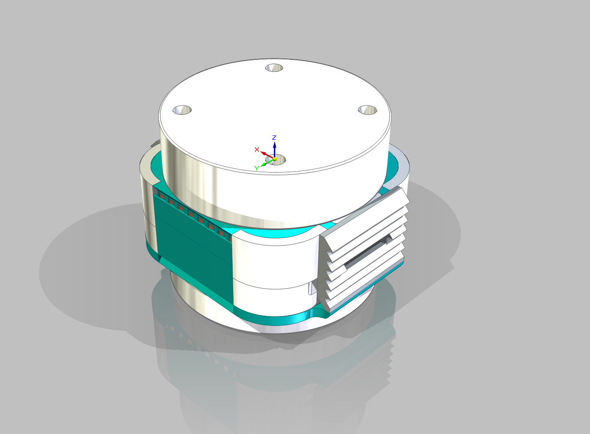

# 机器人手部快换装置

> 人形机器人手腕快换接头设计 —— 第一届“均普杯”迷你科技竞赛作品

## 目录结构
- `Body/` -存放主要内容
- `Note`  -存放零时想法

## 使用方法（包括INDEX）
### 效果图

*手腕快换接头整体效果 - 实物渲染效果*

### 项目简介
本项目为**人形机器人手部快换装置**，旨在解决现有电动快换接头在断电时无法自锁、小型化困难等问题。设计了一种新型电磁+机械混合快换机构，实现**插入即锁定、拔出即松脱**，同时具备断电自锁、超重保护、手动应急松脱等多种功能，适用于人形机器人灵巧手快速更换场景。
**竞赛**：第一届“均普杯”迷你科技竞赛

### 核心亮点
- **真快换**：插入即锁定，拔出即松脱，无需额外操作
- **断电保护**：常闭式自锁结构，断电时仍能可靠锁定
- **超重保护**：载荷过大时自动保护下端工件不脱落
- **多种松脱方式**：电磁铁驱动 + 手动松脱（带防误触设计）
- **抗加速度**：采用弹簧结构，可抵抗任意方向加速度与角加速度
- **小型化**：总体尺寸约 4cm×4cm×3.9cm（不含法兰盘仅1.7cm）

### 技术亮点总结
- 采用4个斜面滑块 + 弹簧 + 电磁铁混合机构
- 下法兰盘多方向受力分析与超重保护机制
- 内置FPC线 + 铜弹片导电方案，实现小型化与高可靠性
- 多种松脱方式（电磁/手动/丝杆改装）

## 保留内容

### 学习许可与权利保留

- 本项目允许个人、学校和研究者进行非商业性的学习、研究和引用。
- 未经著作权人书面许可，不得将项目内容用于商业开发、产品制造、商业服务、商业宣传、投标交付、毕业设计成品交付或再授权。
- 不得删除作者、来源、版本历史和第三方许可证声明，不得将本项目或其衍生成果宣称为与作者无关的原创项目。
- 软件源码适用 [PolyForm Noncommercial 1.0.0](https://polyformproject.org/licenses/noncommercial/1.0.0/)；机械模型、PCB、原理图、图片、文档、Unity 工程和其他非软件资料适用 [CC BY-NC-ND 4.0](https://creativecommons.org/licenses/by-nc-nd/4.0/)。
- SE、SW、STEP/STP 及其他三维模型仅允许个人或学校进行非商业学习、评审和研究；未经著作权人书面许可，不得用于加工、打样、制造、销售、量产、投标、产品交付、商业宣传、改作或再授权。
- 第三方组件、模板、元件库、外购件模型和工具仍受其原始许可证约束；本声明不扩大作者对第三方内容的权利。

商业使用、产品化、公司内部长期使用、转让或排他性授权需另行取得著作权人的书面许可。